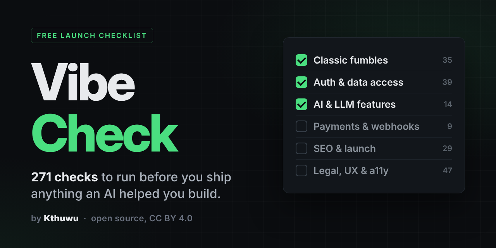

# Vibe Check



**The one checklist to run before you ship anything an AI helped you build.**

By Kthuwu

AI gets you to "it works on my machine" fast. It doesn't get you to safe, findable, legal and production-ready. Vibe Check covers that gap: <!-- total -->271<!-- /total --> checks across <!-- sections -->22<!-- /sections --> sections, each with a one-line reason so you know what to fix and why.

## Quick start

| You have | Do this |
|---|---|
| 10 minutes | Work through [0. Classic fumbles](checklist/00-classic-fumbles.md), the mistakes that actually get vibe-coded apps owned. |
| An afternoon | Do every **Ship-blocker** section (1 to 7), then **High** (8 to 13). |
| A launch coming up | Open a new issue with the **Launch audit** template and tick through everything, or copy [CHECKLIST.md](CHECKLIST.md) into your project. |
| An AI agent | Paste the [audit prompt](#audit-prompt-for-your-ai-agent) below. |

## Contents

<!-- contents:start -->
| # | Section | Theme | Priority | Checks |
|---|---|---|---|---|
| 0 | [Classic fumbles](checklist/00-classic-fumbles.md) | Triage | Start here | 35 |
| 1 | [Secrets & keys](checklist/security/01-secrets-and-keys.md) | Security | Ship-blocker | 10 |
| 2 | [Authentication & sessions](checklist/security/02-authentication-and-sessions.md) | Security | Ship-blocker | 22 |
| 3 | [Authorization & data access](checklist/security/03-authorization-and-data-access.md) | Security | Ship-blocker | 17 |
| 4 | [Input handling & injection](checklist/security/04-input-handling-and-injection.md) | Security | Ship-blocker | 15 |
| 5 | [APIs & endpoints](checklist/security/05-apis-and-endpoints.md) | Security | Ship-blocker | 12 |
| 6 | [Payments & webhooks](checklist/security/06-payments-and-webhooks.md) | Security | Ship-blocker | 9 |
| 7 | [AI & LLM features](checklist/security/07-ai-and-llm-features.md) | Security | Ship-blocker | 14 |
| 8 | [File uploads & storage](checklist/security/08-file-uploads-and-storage.md) | Security | High | 7 |
| 9 | [Transport, headers & cookies](checklist/security/09-transport-headers-and-cookies.md) | Security | High | 10 |
| 10 | [Database](checklist/security/10-database.md) | Security | High | 9 |
| 11 | [Dependencies & supply chain](checklist/security/11-dependencies-and-supply-chain.md) | Security | High | 8 |
| 12 | [CI/CD, accounts & infrastructure](checklist/security/12-cicd-accounts-and-infrastructure.md) | Security | High | 11 |
| 13 | [Logging, monitoring & recovery](checklist/security/13-logging-monitoring-and-recovery.md) | Security | High | 12 |
| 14 | [Attack your own app](checklist/security/14-attack-your-own-app.md) | Security | Every release | 4 |
| 15 | [Production readiness](checklist/launch/15-production-readiness.md) | Launch | Launch | 7 |
| 16 | [SEO & discoverability](checklist/launch/16-seo-and-discoverability.md) | Launch | Launch | 19 |
| 17 | [Social & sharing](checklist/launch/17-social-and-sharing.md) | Launch | Launch | 3 |
| 18 | [Legal, privacy & trust](checklist/legal/18-legal-privacy-and-trust.md) | Legal | Launch | 15 |
| 19 | [UX states & polish](checklist/quality/19-ux-states-and-polish.md) | Quality | Quality | 21 |
| 20 | [Mobile & real-world edge cases](checklist/quality/20-mobile-and-real-world-edge-cases.md) | Quality | Quality | 6 |
| 21 | [Accessibility](checklist/quality/21-accessibility.md) | Quality | Quality | 5 |
<!-- contents:end -->

### Priority levels

| Priority | Meaning |
|---|---|
| Start here | The most common, most damaging mistakes. Fix these first. |
| Ship-blocker | Don't launch until every item passes. |
| High | Fix before real users or real money arrive. |
| Every release | Repeat before each major release, not just the first. |
| Launch | Needed to be found, trusted and legally compliant. |
| Quality | What separates a finished product from a generated one. |

## Audit prompt for your AI agent

```text
You are a senior security and launch reviewer. Audit this codebase against CHECKLIST.md.
For every item, mark PASS, FAIL or N/A and cite the file and line as evidence.
For each FAIL, give the smallest fix. Start with section 0 (Classic fumbles), then
sections 1 to 7, and report any ship-blocker before continuing.
Don't mark anything PASS without evidence.
```

## How this repo is organised

```text
vibe-check/
├── README.md                  You are here
├── CHECKLIST.md               Every check in one file (generated)
├── checklist/
│   ├── 00-classic-fumbles.md  Start here
│   ├── security/              Sections 1 to 14
│   ├── launch/                Sections 15 to 17
│   ├── legal/                 Section 18
│   └── quality/               Sections 19 to 21
├── scripts/build.py           Rebuilds CHECKLIST.md, the issue template and this README's contents
└── .github/ISSUE_TEMPLATE/    "Launch audit" issue with every check (generated)
```

Each section file lists its priority, theme and check count, and links to the previous and next sections so you can read straight through.

## Contributing

Additions and fixes are welcome. See [CONTRIBUTING.md](CONTRIBUTING.md).

## License

[CC BY 4.0](LICENSE). Free for everyone to use, share, adapt and sell, as long as you credit **Vibe Check by Kthuwu**.
